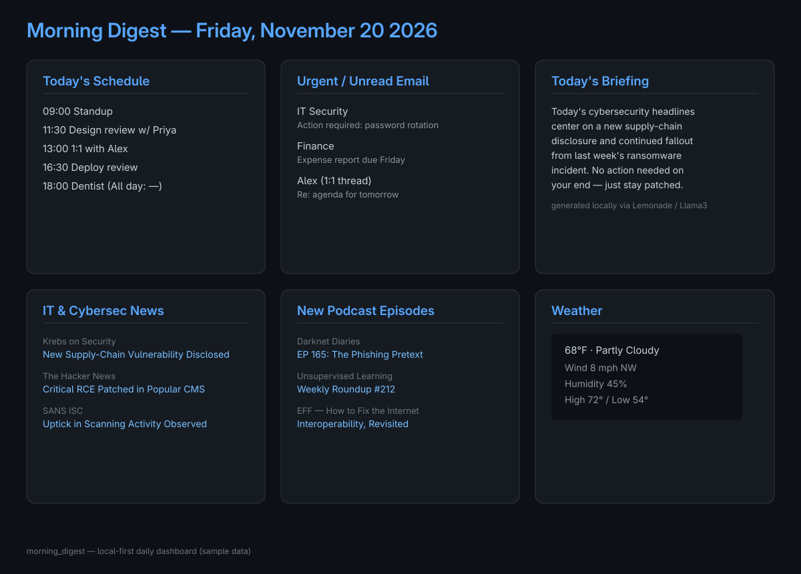

# Morning Digest

A local-first Python framework that builds a single daily digest from:

- **Urgent/unread email** — Gmail API (OAuth), fetched directly
- **Today's schedule** — Google Calendar API (OAuth), fetched directly
- **IT/cybersec headlines** — plain RSS (stdlib `urllib`/`xml.etree`)
- **Recent podcast episodes** — latest episode from each show in an OPML subscription export, flagging any not seen on the previous run
- **Weather** — shells out to [CrustyBarnacle/Utility_Scripts' `weather`](https://github.com/CrustyBarnacle/Utility_Scripts/blob/main/weather) (or any script of your own with similar output)
- **Daily briefing** — a 2-3 sentence summary of the news, generated by a
  local LLM (Llama3 served via [Lemonade](https://github.com/lemonade-sdk/lemonade))

Everything runs standalone with `python3 -m morning_digest.cli` — no Claude
session, no MCP connector, no cloud LLM. Output is a Markdown file (viewable
with [`glow`](https://github.com/charmbracelet/glow)) and a minimal
dark-themed HTML page, both written to `~/.local/share/morning-digest/`
(kept separate from `~/.local/state/morning-digest/`, which holds
credentials/tokens/cached-fetch JSON — so `--serve`, which serves the whole
output directory over local HTTP, never exposes secrets).

Everything is stdlib-only **except** Gmail/Calendar access, which uses
Google's official OAuth/API client libraries (`google-auth`,
`google-auth-oauthlib`, `google-api-python-client`) — hand-rolling OAuth2
token refresh isn't worth the security risk, so that's the one deliberate
exception to "standard libs where possible."



## Setup

1. Create a virtualenv and install the Google client libraries:
   ```
   python3 -m venv .venv && source .venv/bin/activate
   pip install -r requirements.txt
   ```
   or, if you use `uv` (also needs an active venv — `uv pip install` is a
   pip drop-in, not a project manager, so it won't create one for you):
   ```
   uv venv && source .venv/bin/activate
   uv pip install -r requirements.txt
   ```

2. Create a Google OAuth client:
   - Google Cloud Console → APIs & Services → Credentials → Create Credentials
     → OAuth client ID → Application type **Desktop app**.
   - Enable the Gmail API and Calendar API for the project.
   - Download the client JSON and save it as
     `~/.local/state/morning-digest/credentials.json`.
   - First run opens a browser for one-time consent; after that a refresh
     token is cached in `token.json` and you won't be prompted again.

3. Set up [Lemonade](https://github.com/lemonade-sdk/lemonade) locally and
   confirm it's serving Llama3 on an OpenAI-compatible endpoint
   (default assumed: `http://localhost:13305`). If it's not reachable, the
   digest still builds — the briefing section just gets skipped.

4. Edit `morning_digest/config.py`:
   - `WEATHER_CMD` — command/args for your weather script. Defaults to
     [`weather`](https://github.com/CrustyBarnacle/Utility_Scripts/blob/main/weather)
     (zsh, needs `curl`/`jq`/`bc` on PATH) — install it on your `PATH`, or
     swap in your own, and set location with `-l/--lat`, `--lon`, `-n/--name`
     (it defaults to Los Angeles otherwise).
   - `PODCAST_OPML` — path to an OPML export of your podcast subscriptions.
   - `NEWS_FEEDS` — list of `(name, rss_url)` tuples; edit freely.
   - `LEMONADE_BASE_URL` / `LEMONADE_MODEL` — adjust if yours differ from
     the defaults above.
   - `GMAIL_QUERY` — Gmail search syntax for which messages count (default
     `is:unread`).

5. Run it:
   ```
   python3 -m morning_digest.cli --open-glow
   ```
   or, for a browser view:
   ```
   python3 -m morning_digest.cli --serve
   ```

6. (Optional) In Claude Code, `/morning-digest` or asking for "my morning
   digest" runs the same thing via the `morning-digest` skill.

## Layout

```
morning_digest/
  config.py          user-editable settings
  google_auth.py      shared Gmail/Calendar OAuth handling
  gmail_client.py      fetches unread/urgent email via Gmail API
  calendar_client.py   fetches today's events via Calendar API
  llm_client.py         stdlib HTTP client for the local Lemonade server
  news.py               RSS fetch/parse + LLM briefing
  podcasts.py            OPML parse + recent-episode tracking (flags new ones)
  weather.py              subprocess wrapper around your weather command
  email_section.py        renders fetched email as markdown
  schedule.py              renders fetched calendar events as markdown
  render.py                 assembles sections into Markdown + minimal HTML
  cli.py                     entry point: python3 -m morning_digest.cli
.claude/skills/morning-digest/SKILL.md   Claude Code convenience wrapper
```

State (OAuth token, podcast dedup, cached fetch JSON) lives in
`~/.local/state/morning-digest/`; the generated digest files (Markdown/HTML/CSS)
live in `~/.local/share/morning-digest/` — both separate from the project
directory.

## Roadmap

- **v2.0**: optional MCP-based backend for Gmail/Calendar (useful inside a
  Claude Code session without local OAuth setup) as an alternative to the
  direct-API path above.
